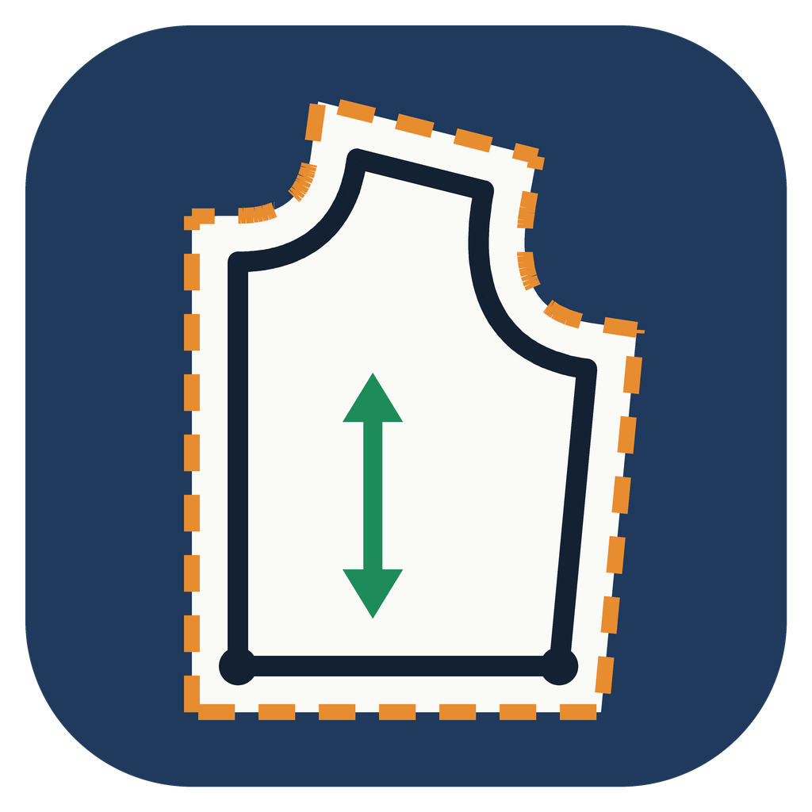
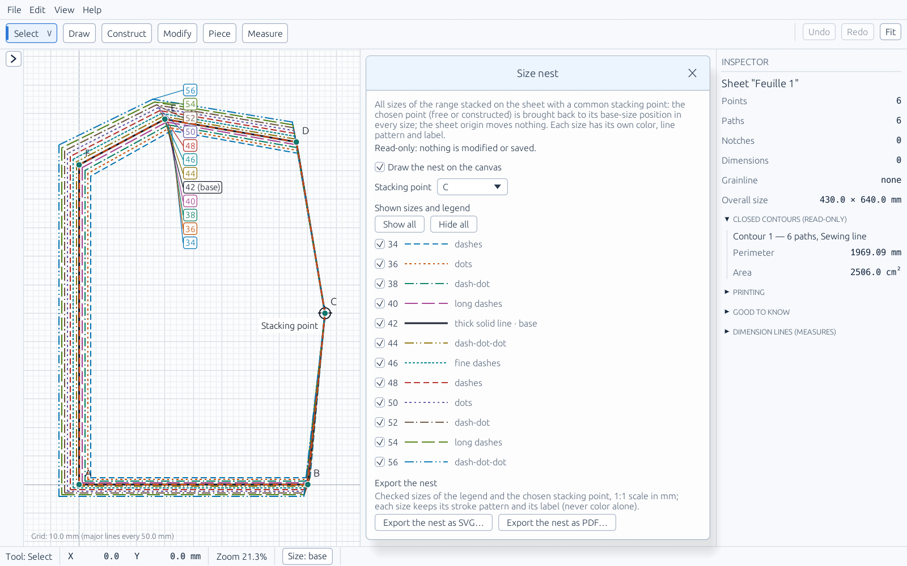
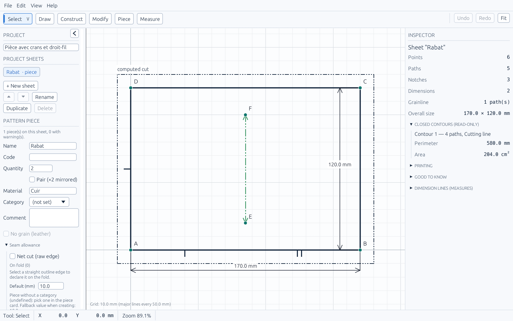
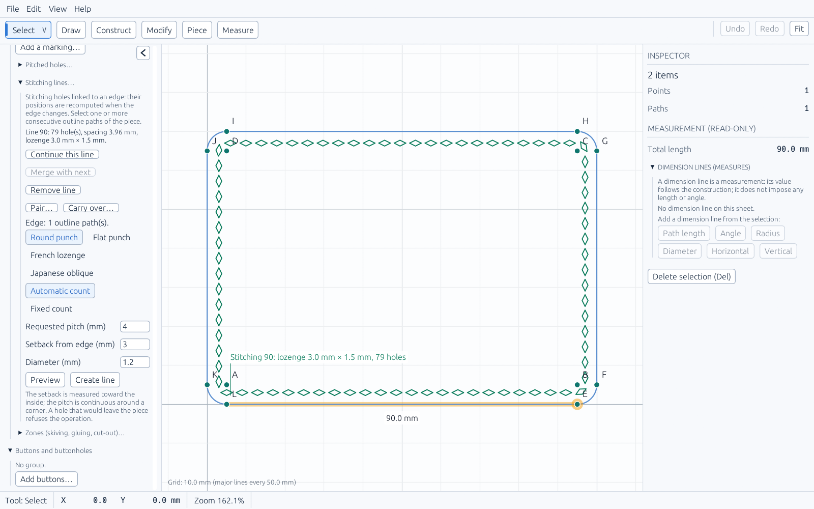
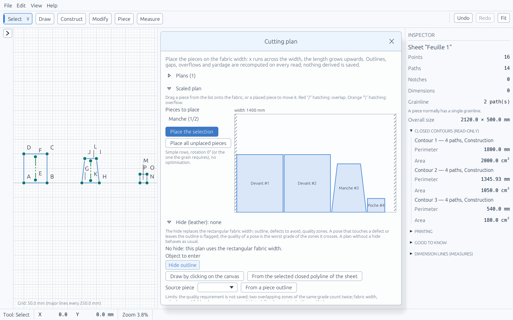

<p align="center"></p>

# PatternForge

**Un atelier de CAO 2D gratuit et entièrement hors ligne pour le patronage de couture et de maroquinerie — écrit en Rust.**
Construisez les pièces en millimètres avec des longueurs et des angles saisis, ajoutez les marges, gradez les
tailles, placez la coupe et imprimez à l'échelle 1:1.

[](https://github.com/VictorLetirand/PatternForge/actions/workflows/ci.yml)
[](LICENSE)


🇬🇧 [English version](README.md) · 🇫🇷 Français



> **État : prototype (0.1.0).** PatternForge est riche en fonctions et très testé (plus de 3 600 tests
> automatiques), mais **aucune modéliste ne l'a encore validé** et **aucune impression n'a été mesurée sur
> papier**. Il n'a été utilisé que **sous Windows** : les versions Linux et macOS compilent et passent les
> tests en CI, mais personne n'y a encore utilisé l'application. Avant de couper dans la matière, imprimez le
> carré étalon de 100 mm et mesurez-le.
> L'interface existe en **français (par défaut) et en anglais** (*Affichage › Langue*, ou `--lang en`).

## Pourquoi PatternForge ?

- **Hors ligne et privé.** Ni compte, ni nuage, ni télémétrie. Un projet est un fichier texte lisible et
  versionné sur votre disque, au [format documenté](docs/FORMAT_PFORGE_V6.md).
- **Précis par construction.** Longueurs, angles, perpendiculaires, courbes avec leur longueur développée, en
  millimètres. Les pixels n'entrent jamais dans le modèle.
- **Honnête sur les liens.** Une mesure est une lecture, pas une contrainte. Les pièces ne suivent leurs
  références que là où vous le demandez.
- **Du tracé à la coupe.** Marges, crans, pinces, gradation, plan de coupe, PDF 1:1 sur plusieurs pages, DXF
  et traceur.
- **Couture et cuir.** Métrage tissu, mais aussi lignes de piqûre, zones de parage et placement sur une peau
  avec ses défauts.
- **Prêt pour les assistants IA.** Un [serveur MCP](#avec-un-assistant-ia-mcp) local, en lecture seule tant
  que vous n'autorisez pas l'écriture.

| Marges de couture | Lignes de piqûre |
|---|---|
|  |  |



## Installer

Télécharger la **[pré-version 0.1.0-rc.1](https://github.com/VictorLetirand/PatternForge/releases/tag/v0.1.0-rc.1)** (les sommes de contrôle sont sur la même page) :

| Système | Installateur |
|---|---|
| **Windows 10 / 11** | [Programme d'installation](https://github.com/VictorLetirand/PatternForge/releases/download/v0.1.0-rc.1/patternforge_0.1.0-rc.1_x64-setup.exe) |
| **macOS** | [Apple Silicon](https://github.com/VictorLetirand/PatternForge/releases/download/v0.1.0-rc.1/PatternForge_0.1.0-rc.1_aarch64.dmg) · [Intel](https://github.com/VictorLetirand/PatternForge/releases/download/v0.1.0-rc.1/PatternForge_0.1.0-rc.1_x64.dmg) |
| **Linux** | [.deb](https://github.com/VictorLetirand/PatternForge/releases/download/v0.1.0-rc.1/patternforge_0.1.0-rc.1_amd64.deb) · [AppImage](https://github.com/VictorLetirand/PatternForge/releases/download/v0.1.0-rc.1/patternforge_0.1.0-rc.1_x86_64.AppImage) |

Les installateurs ne sont **pas signés**. Sous Windows, SmartScreen avertit : *Informations
complémentaires* → *Exécuter quand même*. Sous macOS, après avoir copié l'application dans *Applications*,
lancer `xattr -dr com.apple.quarantine /Applications/PatternForge.app`.

### Compiler depuis les sources

Une chaîne [Rust](https://rustup.rs) stable récente est nécessaire (essayé avec la 1.90).

```bash
git clone https://github.com/VictorLetirand/PatternForge.git
cd PatternForge
cargo run --release -p pf-desktop              # lancer l'application
cargo run --release -p pf-desktop -- --demo    # …avec l'exercice de référence
```

On peut aussi passer le chemin d'un projet à ouvrir. Des exemples sont dans [`examples/`](examples).

**Linux :** installer d'abord les bibliothèques de fenêtrage et de dialogues :

```bash
sudo apt-get install -y libgtk-3-dev libxkbcommon-dev libwayland-dev libxcb-render0-dev libxcb-shape0-dev libxcb-xfixes0-dev
```

**macOS :** les menus affichent « Ctrl » là où le raccourci utilise la touche Cmd.

## Fonctions

- **Tracé :** segment, rectangle, perpendiculaire, parallèle, point à distance, courbes de Bézier et lisses,
  cercle, arc, congé, chanfrein, tangente, décalage, lignes d'aide, accrochage, points relatifs, divisions,
  alignement, symétrie liée, construction rapide.
- **Paramétrique, à la demande :** variables et formules, constructions maintenues, longueur de courbe
  imposée, diagnostic des liens.
- **Pièces :** extraction de zones fermées, fiches, marges avec types de coins et ourlets, crans, droit-fil,
  pinces et transfert, plis, ampleur, perçages, boutons, pièces dérivées, séparer, assembler, déplier,
  contrôle d'assemblage et rapport.
- **Tailles :** gammes, gradation par point, copie et interpolation de règles, nid de tailles, mesures par
  taille, barème, fiches client, tailles sur mesure.
- **Cuir :** lignes de piqûre et appariement des trous, zones de parage, de collage et de découpe, contour de
  peau avec défauts et grades de qualité.
- **Placement :** plan de pièces, plans de coupe avec contrôles et métrage, placement automatique (une
  proposition, pas un optimiseur).
- **Vie du projet :** calques, groupes, annuler / rétablir, enregistrement atomique et sauvegarde
  automatique, versions nommées, bibliothèque, variantes, nomenclature et fiche technique, photo ou scan à
  décalquer.
- **Import / export :**

  | Format | Ouvrir / importer | Enregistrer / exporter |
  |---|---|---|
  | PatternForge `.pforge` | ✔ (versions 1 à 6, et les anciens `.pforge.json`) | ✔ |
  | PDF | tracés vectoriels seulement | ✔ plusieurs pages, 1:1, page d'étalonnage |
  | SVG | ✔ tracés seulement | ✔ en millimètres |
  | DXF générique | ✔ DXF texte | ✔ géométrie de construction |
  | DXF de pièces, type AAMA / ASTM | ✔ | ✔ (table des couches non confirmée) |
  | HPGL (traceur) | – | ✔ |
  | PNG / JPEG | image de fond à décalquer | ✔ en ligne de commande |

  L'impression directe (Windows seulement) et la projection plein écran sont aussi disponibles.

- **Ligne de commande :** `patternforge-cli` contrôle, convertit, exporte et traite des dossiers
  ([référence](docs/CLI.md)).

Chaque outil et ses limites sont décrits dans le **[guide utilisateur](docs/GUIDE_UTILISATEUR.md)**.

## Avec un assistant IA (MCP)

`pf-mcp-server` est un serveur [Model Context Protocol](https://modelcontextprotocol.io) attaché à **un seul
fichier de projet**. Par défaut il est **en lecture seule** (feuilles, objets, mesures, validation). Avec
`--allow-write`, il peut simuler et appliquer des commandes sur une révision attendue du fichier, les annuler
et exporter, avec un journal à côté du projet. L'application ouverte voit les changements externes et refuse
de les écraser.

```bash
cargo run --release -p pf-mcp --bin pf-mcp-server -- --project chemin/vers/projet.pforge
```

Référence et limites : [crates/pf-mcp/README.md](crates/pf-mcp/README.md).

## État par système

| | Windows | Linux | macOS |
|---|---|---|---|
| Compile et passe les tests automatiques (CI) | ✔ | ✔ | ✔ |
| Application lancée et utilisée par une personne | ✔ | pas encore | pas encore |
| Impression directe | ✔ | – | – |
| Installateurs publiés (pré-version, non signés) | ✔ | ✔ | ✔ |

## Limites connues

- Pas de solveur de contraintes général.
- Pas de fichier de règles de gradation `.rul` ; aucune compatibilité avec un logiciel métier n'est annoncée.
- Le placement automatique n'est ni optimal ni garanti minimal.
- Les imports n'ont pas été essayés avec des fichiers de logiciels métier.
- Les conventions métier (marges, coins, gradation, placement) restent à confirmer par une modéliste.

## Organisation

| Dossier | Rôle |
|---|---|
| [`crates/pf-geometry`](crates/pf-geometry) | Calculs géométriques purs, en mm |
| [`crates/pf-core`](crates/pf-core) | Modèle, commandes, annuler / rétablir, fichiers |
| [`crates/pf-export`](crates/pf-export) | Exports et imports (PDF, SVG, DXF, HPGL, images) |
| [`crates/pf-i18n`](crates/pf-i18n) | Textes français et anglais |
| [`crates/pf-ui`](crates/pf-ui) | Éléments d'interface partagés |
| [`crates/pf-cli`](crates/pf-cli) | Ligne de commande |
| [`crates/pf-mcp`](crates/pf-mcp) | Serveur MCP local |
| [`apps/pf-desktop`](apps/pf-desktop) | Application (egui) |
| [`examples/`](examples) | Projets d'exemple et exports de référence, comparés octet par octet par les tests |

## Développement

```bash
cargo fmt --all -- --check
cargo clippy --workspace --all-targets -- -D warnings
cargo test --workspace
```

Les tests d'intégration de `pf-core` et `pf-export` forment un seul programme par paquet (`tests/suite.rs`) :
tout nouveau fichier de test s'ajoute à sa liste.

Les commentaires du code citent parfois des numéros de story ou de décision venant de documents de travail
internes, qui ne sont pas publiés.

## Pistes

Souhaité ensuite, sans date :

- Relecture des conventions métier et premier essai avec une modéliste.
- Impression et mesure de l'étalon sur de vraies imprimantes.
- Premier usage réel sous Linux et macOS, et binaires téléchargeables.
- Fichiers de gradation `.rul`, macros, vectorisation automatique d'images.

Un bug ou une idée ? [Ouvrez un ticket](https://github.com/VictorLetirand/PatternForge/issues).

## Licence

PatternForge est un logiciel libre sous [licence MIT](LICENSE). Les composants tiers gardent leurs propres
licences (permissives) : voir [THIRD-PARTY.md](THIRD-PARTY.md).
