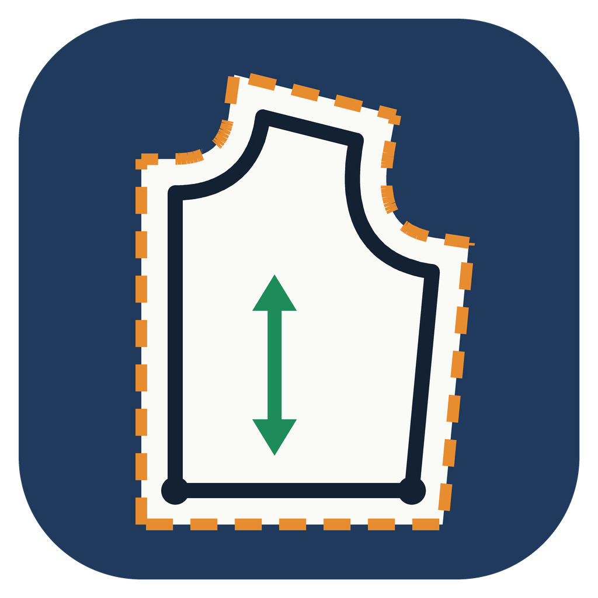
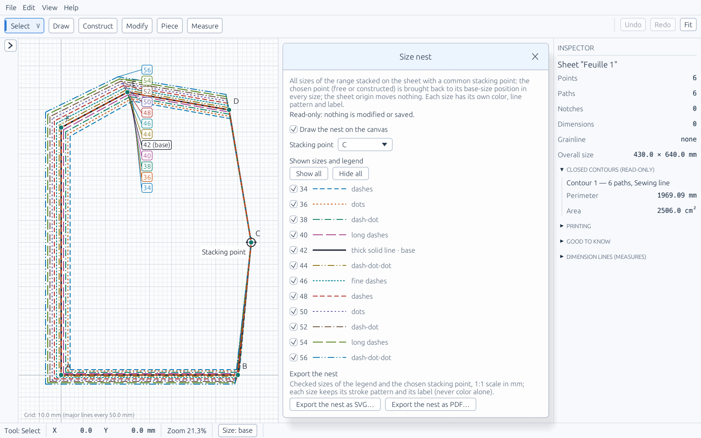
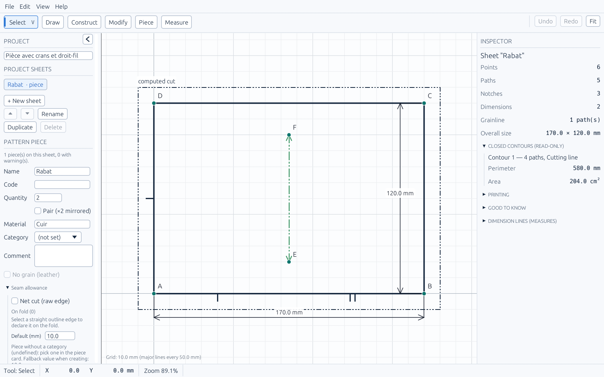
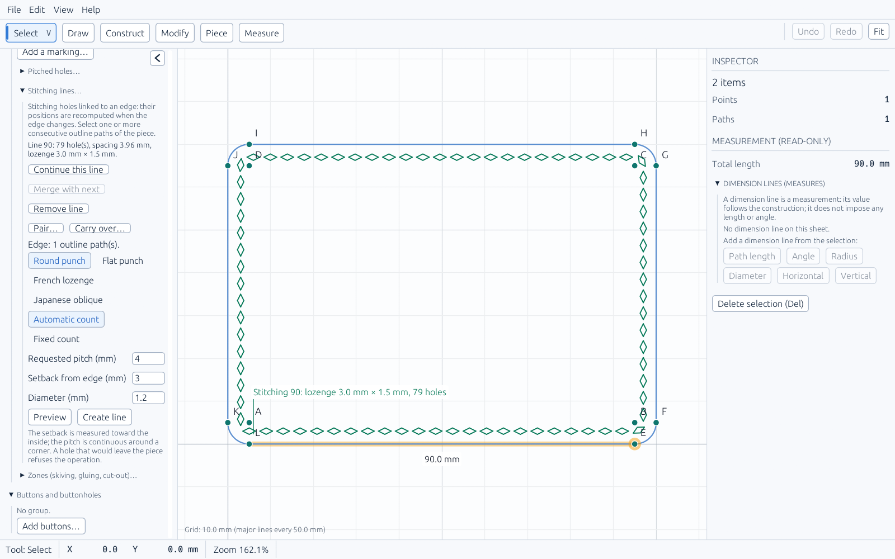
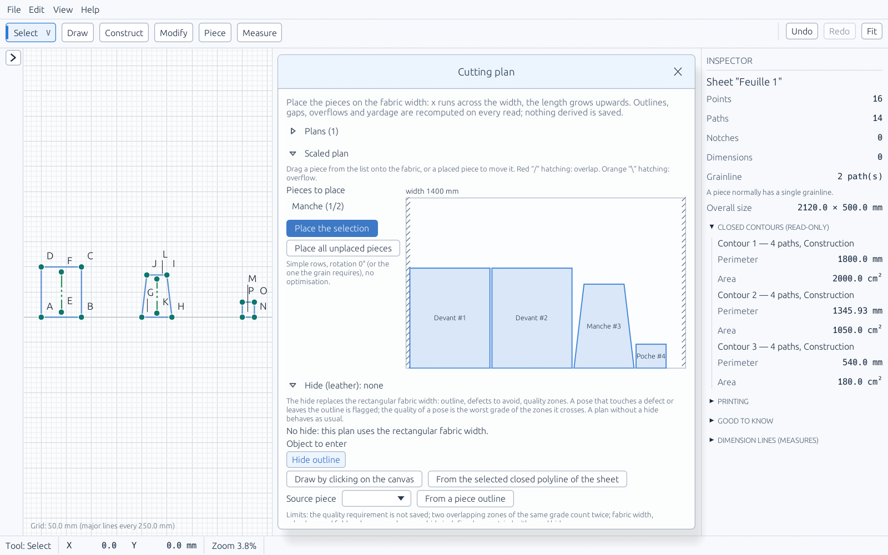

<p align="center"></p>

# PatternForge

**A free, fully offline 2D CAD workshop for sewing and leather pattern drafting — written in Rust.**
Draft pieces in millimetres with typed lengths and angles, add seam allowances, grade sizes, lay out the
cut and print at true 1:1 scale.

[](https://github.com/VictorLetirand/PatternForge/actions/workflows/ci.yml)
[](LICENSE)


🇬🇧 English · 🇫🇷 [Version française](README.fr.md)



> **Status: prototype (0.1.0).** PatternForge is feature-rich and heavily tested (over 3,600 automated
> tests), but **no pattern maker has validated it yet** and **no print has been measured on paper**.
> It has been used on **Windows only**: Linux and macOS builds compile and pass the tests in CI, yet nobody
> has used the application there by hand. Before cutting material, print the 100 mm calibration square and
> measure it.
> The interface is available in **French (default) and English** (*View › Language*, or `--lang en`).

## Why PatternForge?

- **Offline and private.** No account, no cloud, no telemetry. A project is a readable, versioned text file
  on your disk, with a [documented format](docs/FORMAT_PFORGE_V6.md).
- **Precise by construction.** Lengths, angles, perpendiculars and curves with their developed length, in
  millimetres. Screen pixels never enter the model.
- **Honest about what is linked.** A measurement is a reading, not a constraint. Pieces follow their
  references only where you ask for it.
- **From draft to cut.** Seam allowances, notches, darts, grading, cutting plan, tiled PDF at 1:1, DXF and
  plotter output.
- **Sewing and leather.** Fabric yardage as well as stitching-hole lines, skiving zones and layout on a
  hide with its flaws.
- **Ready for AI agents.** A local [MCP server](#use-it-with-ai-agents-mcp), read-only unless you allow
  writing.

| Seam allowances | Stitching lines |
|---|---|
|  |  |



## Install

There is **no published release yet**: build from source.

You need a recent stable [Rust](https://rustup.rs) toolchain (tried with 1.90).

```bash
git clone https://github.com/VictorLetirand/PatternForge.git
cd PatternForge
cargo run --release -p pf-desktop              # start the app
cargo run --release -p pf-desktop -- --demo    # …with a reference exercise
```

You can also pass the path of a project to open. Example projects are in [`examples/`](examples).

**Linux:** install the windowing and dialog libraries first:

```bash
sudo apt-get install -y libgtk-3-dev libxkbcommon-dev libwayland-dev libxcb-render0-dev libxcb-shape0-dev libxcb-xfixes0-dev
```

**macOS:** the application is not signed with Apple. A downloaded binary is blocked on first launch: allow
it in *System Settings › Privacy & Security*, or remove the quarantine flag from the unpacked folder
(`xattr -dr com.apple.quarantine <folder>`). Menus show “Ctrl” where the shortcut uses the Cmd key.

## Features

- **Drafting:** segment, rectangle, perpendicular, parallel, point at distance, Bézier and smooth curves,
  circle, arc, fillet, chamfer, tangent, offset, guides, snapping, relative points, divisions, alignment,
  linked symmetry, quick construction.
- **Parametric, on demand:** variables and formulas, maintained constructions, imposed curve length, link
  diagnostics.
- **Pieces:** extraction from closed areas, piece cards, seam allowances with corner types and hems,
  notches, grainline, darts and dart transfer, pleats, flare, drill holes, buttons, derived pieces, split,
  join, unfold, assembly checks and control report.
- **Sizes:** size ranges, point grading, rule copy and interpolation, size nest, measures by size,
  measurement tables, client records, made-to-measure sizes.
- **Leather:** stitching lines and hole pairing, skiving, gluing and cut-out zones, hide outline with flaws
  and quality grades.
- **Layout:** pieces plan, cutting plans with checks and yardage, automatic placement (a proposal, not an
  optimiser).
- **Project life:** layers, groups, undo/redo, atomic save and autosave, named versions, library, variants,
  bill of materials and technical sheet, background photo or scan to trace.
- **Import / export:**

  | Format | Open / import | Save / export |
  |---|---|---|
  | PatternForge `.pforge` | ✔ (versions 1 to 6, and older `.pforge.json`) | ✔ |
  | PDF | vector paths only | ✔ tiled, 1:1, calibration page |
  | SVG | ✔ paths only | ✔ in millimetres |
  | DXF, generic | ✔ text DXF | ✔ construction geometry |
  | DXF, AAMA / ASTM-type pieces | ✔ | ✔ (layer table unconfirmed) |
  | HPGL (plotter) | – | ✔ |
  | PNG / JPEG | background image to trace | ✔ from the command line |

  Direct printing (Windows only) and full-screen projection are also available.

- **Command line:** `patternforge-cli` checks, converts, exports and batch-processes projects
  ([reference](docs/CLI.md), in French).

Every tool and its limits are described in the **[user guide](docs/USER_GUIDE.md)**.

## Use it with AI agents (MCP)

`pf-mcp-server` is a [Model Context Protocol](https://modelcontextprotocol.io) server bound to **one
project file**. By default it is **read-only** (sheets, entities, measurements, validation). With
`--allow-write` it can preview and apply editing commands against an expected file revision, undo them and
export, with a journal next to the project. The open application notices external changes and refuses to
overwrite them.

```bash
cargo run --release -p pf-mcp --bin pf-mcp-server -- --project path/to/project.pforge
```

Reference and limits: [crates/pf-mcp/README.md](crates/pf-mcp/README.md) (in French).

## Platform status

| | Windows | Linux | macOS |
|---|---|---|---|
| Builds and passes the automated tests (CI) | ✔ | ✔ | ✔ |
| Application launched and used by hand | ✔ | not yet | not yet |
| Direct printing | ✔ | – | – |
| Published binaries | not yet | not yet | not yet |

## Known limits

- No general constraint solver.
- No grading rule file (`.rul`); no compatibility with industry software is claimed.
- Automatic placement is neither optimal nor guaranteed minimal.
- Imports have not been tried with files from industry software.
- Trade conventions (allowances, corners, grading, layout) still have to be confirmed by a pattern maker.

## Project layout

| Folder | Role |
|---|---|
| [`crates/pf-geometry`](crates/pf-geometry) | Pure geometry, in mm |
| [`crates/pf-core`](crates/pf-core) | Model, editing commands, undo / redo, files |
| [`crates/pf-export`](crates/pf-export) | Exports and imports (PDF, SVG, DXF, HPGL, images) |
| [`crates/pf-i18n`](crates/pf-i18n) | French and English texts |
| [`crates/pf-ui`](crates/pf-ui) | Shared interface elements |
| [`crates/pf-cli`](crates/pf-cli) | Command line |
| [`crates/pf-mcp`](crates/pf-mcp) | Local MCP server |
| [`apps/pf-desktop`](apps/pf-desktop) | Desktop application (egui) |
| [`examples/`](examples) | Example projects and reference exports, compared byte by byte by the tests |

## Development

```bash
cargo fmt --all -- --check
cargo clippy --workspace --all-targets -- -D warnings
cargo test --workspace
```

The integration tests of `pf-core` and `pf-export` form a single program per crate (`tests/suite.rs`): add
any new test file to its list.

Source comments and most technical documents are in French. Comments sometimes cite story or decision
numbers from internal working documents that are not published.

## Roadmap

Wanted next, without a date:

- Review of the trade conventions and a first test with a pattern maker.
- Print and measure the calibration square on real printers.
- First real use on Linux and macOS, and downloadable builds.
- `.rul` grading files, macros, automatic image vectorisation.

Found a bug or have an idea? [Open an issue](https://github.com/VictorLetirand/PatternForge/issues).

## License

PatternForge is free software under the [MIT license](LICENSE). Third-party components keep their own
(permissive) licenses: see [THIRD-PARTY.md](THIRD-PARTY.md) (in French).
